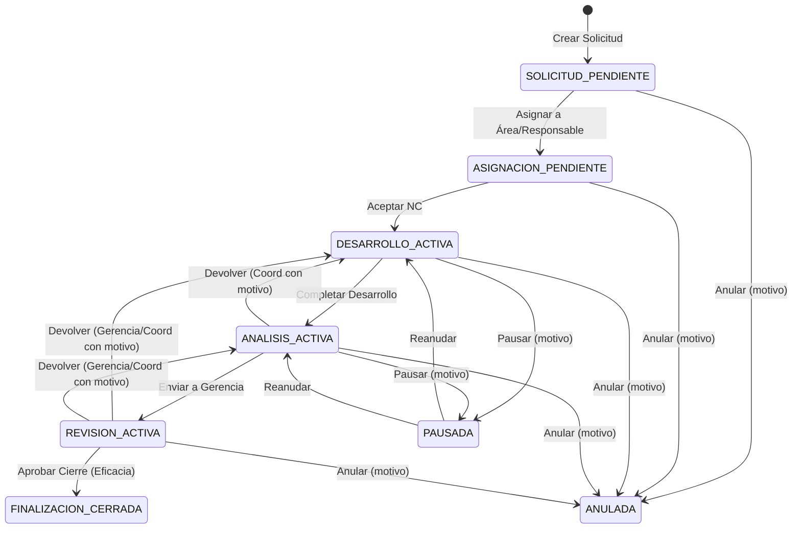

# DDS-004 — Máquina de Estados, Transiciones y Permisos (v1.0)

> **Proyecto:** SIGNC — Sistema Integral de Gestión de Calidad  
> **Estado:** Propuesta para aprobación (Paso 2)  
> **Base:** `Context.md` + `Explicación.md` + `MDD-002`

---

## 1. Fases vs. Estados Operativos (Módulo 1: SNC / AC / OM)

- **Fases (`fase_actual`):** `SOLICITUD` → `ASIGNACION` → `DESARROLLO` → `ANALISIS` → `REVISION` → `FINALIZACION`
- **Estados (`estado_actual`):**
  - `PENDIENTE`: Creada en Solicitud sin asignar, o asignada esperando aceptación del área/responsable.
  - `ACTIVA`: En ejecución dentro de su fase actual (corre el reloj de tiempo neto).
  - `PAUSADA`: Detenida temporalmente con motivo obligatorio (el tiempo en pausa no suma al tiempo neto).
  - `CERRADA`: Revisada y aprobada por Gerencia en `FINALIZACION` (solo lectura / inmutable).
  - `ANULADA`: Cancelada con motivo obligatorio (solo lectura, disponible en indicadores).

---

## 2. Matriz de Permisos por Rol

| Acción / Capacidad | `GERENCIA` | `COORDINADOR` | `LIDER` / `COLABORADOR` |
| :--- | :---: | :---: | :---: |
| **Solicitar NC / OM** | ✅ | ✅ | ✅ |
| **Asignar NC a cualquier área** | ✅ | ✅ (a su área o solicita a otra) | Solo solicitar asignación a otra área |
| **Aceptar NC entrante** | — | ✅ (de su área) | ✅ (si le fue asignada) |
| **Reasignar dentro del área** | ✅ | ✅ (su área) | ❌ |
| **Desarrollar / Analizar** | ✅ | ✅ (su área) | ✅ (solo asignadas a él) |
| **Pausar / Reanudar** | ✅ (cualquiera) | ✅ (su área) | ❌ |
| **Devolver a fase anterior** | ✅ (cualquiera, con motivo) | ✅ (su área, con motivo) | ❌ |
| **Revisar y Aprobar Cierre** | ✅ (exclusivo) | ❌ | ❌ |
| **Anular NC (con motivo)** | ✅ (cualquiera) | Solo las que él solicitó | Solo las que él solicitó |
| **Visibilidad (Monitoreo)** | Todas las áreas y personas | Su área (líderes/colaboradores) | Sus propias asignadas/solicitadas |

### Tarjetas del Panel Principal por Rol
- **Gerencia:** *Pendientes por Asignar*, *Pendientes por Revisar (Cierre)*, *Activas por Área*, *Pausadas / Vencidas*.
- **Coordinador de Área:** *Por Aceptar (Entrantes)*, *Por Asignar en mi Área*, *Activas de mi Equipo*, *Mis Solicitadas*.
- **Líder / Colaborador:** *Por Aceptar*, *Mis Activas en Desarrollo/Análisis*, *Solicitudes de Traslado*, *Mis Solicitadas*.

---

## 3. Validaciones Obligatorias por Transición

| Transición | Campos / Condiciones Obligatorias |
| :--- | :--- |
| **Crear `SOLICITUD`** | `tipo_hallazgo`, `area_identifica_id`, `resumen_solicitud` (motivo corto diciente). Genera consecutivo (`SNC-AAAA-NNN` / `OM-AAAA-NNN`). |
| **`SOLICITUD` → `ASIGNACION`** | `area_asignada_id` (y opcionalmente `responsable_actual_id`). Crea registro en `SNC_Asignaciones` (`aceptada = FALSE`). |
| **`ASIGNACION` → `DESARROLLO`** | Aceptación explícita (`aceptada = TRUE`, `fecha_aceptacion`), `responsable_actual_id` definido. |
| **`DESARROLLO` → `ANALISIS`** | `descripcion_detalle`, `origen_snc`, `fuente_deteccion`, `fecha_deteccion`, `involucrado_area_id`. Si el área tiene `requiere_datos_tecnicos = TRUE` (Producción), exige al menos 1 dato técnico en `datos_tecnicos_json` (calibre, longitud, peso o maquinaria). La corrección inmediata (`SNC_Correcciones`) debe quedar resuelta si aplica. |
| **`ANALISIS` → `REVISION`** | Si es SNC: al menos 1 registro en `SNC_Analisis` (`metodo`, `causa_raiz`, `responsable_id`). Si es OM: `beneficios_oportunidad`. Planes/Actividades y Costos (`SNC_Costos`) registrados si aplican. |
| **`REVISION` → `FINALIZACION`** | Exclusivo `GERENCIA`. Exige `resultado_cierre` (`IMPLEMENTADA_EFICAZ`, `IMPLEMENTADA_NO_EFICAZ` o `NO_IMPLEMENTADA`). Calcula `tiempo_neto_min` descontando pausas y bloquea edición. |
| **`PAUSA` / `DEVOLUCION` / `ANULACION`** | Exige `motivo` no vacío; se registra en `HIS_Historial` con timestamp exacto. |

---

## 4. Flujo del Módulo 2 — Auditorías 5S (`AUD_`)

1. **`PROGRAMADA`:** Coordinador o Gerencia programa auditoría seleccionando plantilla (`5S`), `area_id`, `auditor_id` y `fecha_programada`.
2. **`EN_CURSO`:** El auditor evalúa cada criterio (`SI` / `NO` / `NA`), adjunta fotos en `EVI_Evidencias` y agrega observaciones.
3. **`FINALIZADA`:** El sistema calcula `puntaje_obtenido`, `puntaje_maximo` y `porcentaje`. Por cada criterio en `NO` marcado para generar hallazgo, se crea automáticamente un expediente en `SNC_Hallazgos` (`origen_modulo = 'AUDITORIA'`, `origen_referencia_id = auditoria_id`) en fase `SOLICITUD` o `ASIGNACION` hacia el coordinador del área auditada.
