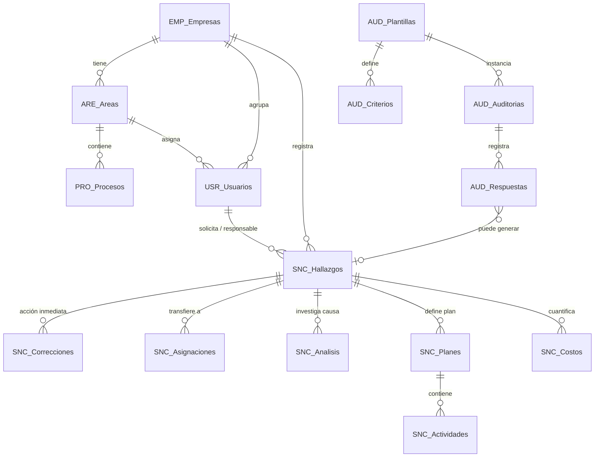

# MDD-002 — Modelo de Datos para Google Sheets (v1.0)

> **Proyecto:** SIGNC — Sistema Integral de Gestión de Calidad  
> **Estado:** Propuesta para aprobación (Paso 1)  
> **Motor v1:** Google Sheets (1 pestaña por entidad) + Google Drive (evidencias)  
> **Alcance del documento:** Núcleo Compartido (Core) + Módulo 1 (SNC/AC/OM) + Módulo 2 (Auditorías 5S) + Puntos de extensión para Olas 1, 2 y 3.

---

## 1. Principios de Diseño en Google Sheets

1. **Separación por prefijos de módulo:** `COR_` / `EMP_` / `USR_` (Núcleo), `SNC_` (Módulo 1), `AUD_` (Módulo 2). Facilita migrar pestañas pesadas a libros separados o a PostgreSQL en la v2.
2. **Aislamiento multiempresa:** Toda entidad maestra y transaccional principal incluye `empresa_id`. El backend `.gs` filtra siempre por la empresa de la sesión.
3. **Evidencias e Historial polimórficos:** En lugar de crear tablas de fotos o logs por cada módulo, `EVI_Evidencias` y `HIS_Historial` usan `(modulo, entidad_tipo, entidad_id)`. Cualquier módulo futuro (5S, Metrología, PQRS, Inspección) los reutiliza sin cambios.
4. **Campos dinámicos por área en JSON:** En `SNC_Hallazgos`, el campo `datos_tecnicos_json` almacena atributos específicos del área (p. ej. Producción: `calibre`, `longitud`, `peso`, `maquinaria`) sin llenar de columnas vacías los casos de Comercial o Administrativa.

---

## 2. Diagrama Entidad–Relación (Core + M1 + M2)

---

## 3. Núcleo Compartido (Core)

### `EMP_Empresas`
| Columna | Tipo | Descripción |
| :--- | :--- | :--- |
| `id` | Texto (UUID/EMP-01) | Identificador único |
| `nombre` | Texto | Razón social / nombre corto |
| `nit` | Texto | Identificación tributaria |
| `activa` | Booleano | `TRUE` / `FALSE` |
| `creado_en` | FechaHora ISO | Timestamp de creación |

### `ARE_Areas`
| Columna | Tipo | Descripción |
| :--- | :--- | :--- |
| `id` | Texto (ARE-01) | Identificador único |
| `empresa_id` | FK → `EMP_Empresas.id` | Empresa propietaria |
| `nombre` | Texto | Ej. Producción, Comercial, Diseño, Calidad |
| `requiere_datos_tecnicos` | Booleano | `TRUE` para Producción (habilita calibre, peso, máquina, etc.) |
| `activa` | Booleano | `TRUE` / `FALSE` |

### `PRO_Procesos`
| Columna | Tipo | Descripción |
| :--- | :--- | :--- |
| `id` | Texto (PRO-01) | Identificador único |
| `empresa_id` | FK → `EMP_Empresas.id` | Empresa propietaria |
| `area_id` | FK → `ARE_Areas.id` | Área a la que pertenece |
| `nombre` | Texto | Ej. Corte, Doblez, Soldadura, Cotización |
| `activo` | Booleano | `TRUE` / `FALSE` |

### `USR_Usuarios` (Login propio)
| Columna | Tipo | Descripción |
| :--- | :--- | :--- |
| `id` | Texto (USR-01) | Identificador único |
| `empresa_id` | FK → `EMP_Empresas.id` | Empresa asignada |
| `area_id` | FK → `ARE_Areas.id` | Área principal |
| `nombre` | Texto | Nombre completo |
| `usuario` | Texto | Usuario único de acceso (o correo) |
| `password_hash` | Texto | Hash SHA-256 + salt (nunca texto plano) |
| `rol` | Enum | `GERENCIA` \| `COORDINADOR` \| `LIDER` \| `COLABORADOR` \| `ADMIN` |
| `activo` | Booleano | `TRUE` / `FALSE` |

### `CFG_Catalogos`
| Columna | Tipo | Descripción |
| :--- | :--- | :--- |
| `id` | Texto | Identificador único |
| `empresa_id` | FK → `EMP_Empresas.id` | Empresa (o `GLOBAL`) |
| `modulo` | Texto | `SNC`, `AUD`, etc. |
| `grupo` | Texto | `ORIGEN`, `FUENTE_DETECCION`, `METODO_ANALISIS`, `TIPO_CORRECCION`, `CAT_COSTO` |
| `valor` | Texto | Etiqueta visible |
| `activo` | Booleano | `TRUE` / `FALSE` |

### `EVI_Evidencias` (Polimórfica — Drive)
| Columna | Tipo | Descripción |
| :--- | :--- | :--- |
| `id` | Texto | Identificador único |
| `empresa_id` | FK → `EMP_Empresas.id` | Empresa |
| `modulo` | Texto | `SNC`, `AUD`, etc. |
| `entidad_tipo` | Texto | `HALLAZGO`, `ACTIVIDAD`, `AUDITORIA_RESPUESTA` |
| `entidad_id` | Texto | ID del registro asociado |
| `nombre_archivo` | Texto | Nombre original |
| `drive_file_id` | Texto | ID del archivo en Google Drive |
| `url` | Texto | Enlace de visualización |
| `subido_por_id` | FK → `USR_Usuarios.id` | Usuario que cargó |
| `creado_en` | FechaHora ISO | Timestamp |

### `HIS_Historial` (Polimórfica — Trazabilidad y Tiempos)
| Columna | Tipo | Descripción |
| :--- | :--- | :--- |
| `id` | Texto | Identificador único |
| `empresa_id` | FK → `EMP_Empresas.id` | Empresa |
| `modulo` | Texto | `SNC`, `AUD`, etc. |
| `entidad_id` | Texto | ID del expediente (ej. `SNC-2026-001`) |
| `evento` | Texto | `CREACION`, `ASIGNACION`, `ACEPTACION`, `CAMBIO_FASE`, `PAUSA`, `REANUDACION`, `DEVOLUCION`, `ANULACION`, `CIERRE` |
| `fase_anterior` | Texto | Fase previa |
| `fase_nueva` | Texto | Fase resultante |
| `estado_anterior` | Texto | Estado previo |
| `estado_nuevo` | Texto | Estado resultante |
| `usuario_id` | FK → `USR_Usuarios.id` | Quién ejecutó la acción |
| `motivo` | Texto | Obligatorio en pausas, devoluciones y anulaciones |
| `creado_en` | FechaHora ISO | Timestamp exacto para cálculo de tiempos |

---

## 4. Módulo 1 — Salidas No Conformes, AC y OM (`SNC_`)

### `SNC_Hallazgos`
| Columna | Tipo | Descripción |
| :--- | :--- | :--- |
| `id` | Texto | Identificador interno |
| `empresa_id` | FK → `EMP_Empresas.id` | Empresa |
| `consecutivo` | Texto | Ej. `SNC-2026-001` o `OM-2026-001` |
| `tipo_hallazgo` | Enum | `SNC_REAL` \| `SNC_POTENCIAL` \| `OPORTUNIDAD_MEJORA` |
| `origen_modulo` | Texto | `MANUAL` \| `AUDITORIA` \| `METROLOGIA` \| `RECEPCION_MP` \| `PQRS` \| `INSPECCION` |
| `origen_referencia_id` | Texto | ID en el módulo de origen (si aplica) |
| `fase_actual` | Enum | `SOLICITUD` \| `ASIGNACION` \| `DESARROLLO` \| `ANALISIS` \| `REVISION` \| `FINALIZACION` |
| `estado_actual` | Enum | `PENDIENTE` \| `ACTIVA` \| `PAUSADA` \| `CERRADA` \| `ANULADA` |
| `solicitante_id` | FK → `USR_Usuarios.id` | Quien reporta |
| `area_identifica_id` | FK → `ARE_Areas.id` | Área donde se detecta |
| `proceso_identifica_id` | FK → `PRO_Procesos.id` | Proceso donde se detecta |
| `area_asignada_id` | FK → `ARE_Areas.id` | Área responsable actual |
| `responsable_actual_id` | FK → `USR_Usuarios.id` | Persona con la tarea activa |
| `involucrado_area_id` | FK → `ARE_Areas.id` | Área donde se originó el fallo ("culpable") |
| `involucrado_usuario_id` | FK → `USR_Usuarios.id` | Responsable directo del fallo (si aplica) |
| `resumen_solicitud` | Texto | Motivo corto obligatorio en Solicitud |
| `descripcion_detalle` | Texto | Qué, por qué, cuándo, cómo, dónde, cliente/proyecto |
| `origen_snc` | Texto | Catálogo (`Auditoría`, `PQRS`, `Supervisión`, etc.) |
| `fuente_deteccion` | Texto | Catálogo (`Materia Prima`, `En Proceso`, `Terminado`, etc.) |
| `datos_tecnicos_json` | JSON Texto | Campos dinámicos Producción (`area_m2`, `calibre`, `longitud`, `peso`, `maquinaria`, `op`) |
| `beneficios_oportunidad` | Texto | Aplica cuando `tipo_hallazgo = OPORTUNIDAD_MEJORA` |
| `resultado_cierre` | Enum | `IMPLEMENTADA_EFICAZ` \| `IMPLEMENTADA_NO_EFICAZ` \| `NO_IMPLEMENTADA` |
| `fecha_deteccion` | Fecha | Fecha del hallazgo |
| `fecha_cierre` | FechaHora ISO | Fecha de aprobación final |
| `tiempo_pausado_min` | Número | Minutos acumulados en pausa (para KPI neto) |

### `SNC_Correcciones` (Acción Inmediata)
| Columna | Tipo | Descripción |
| :--- | :--- | :--- |
| `id` | Texto | Identificador único |
| `hallazgo_id` | FK → `SNC_Hallazgos.id` | NC asociada |
| `tipo_correccion` | Enum | `REPROCESO` \| `CONCESION` \| `RETRABAJO` \| `OTRA` |
| `descripcion` | Texto | Acción ejecutada para contener el problema |
| `autorizado_por_id` | FK → `USR_Usuarios.id` | Quién autoriza |
| `responsable_id` | FK → `USR_Usuarios.id` | Quién ejecuta |
| `fecha_ejecucion` | Fecha | Fecha de ejecución |

### `SNC_Asignaciones`
| Columna | Tipo | Descripción |
| :--- | :--- | :--- |
| `id` | Texto | Identificador único |
| `hallazgo_id` | FK → `SNC_Hallazgos.id` | NC asociada |
| `de_usuario_id` | FK → `USR_Usuarios.id` | Quién asigna / transfiere |
| `a_area_id` | FK → `ARE_Areas.id` | Área destino |
| `a_usuario_id` | FK → `USR_Usuarios.id` | Persona destino (puede ser nula si primero recibe Coordinador) |
| `fase` | Texto | Fase en la que se asigna |
| `tipo` | Enum | `INICIAL` \| `ACEPTACION` \| `REASIGNACION` \| `SOLICITUD_OTRA_AREA` \| `REVISION` |
| `motivo` | Texto | Nota o justificación |
| `aceptada` | Booleano | `TRUE` cuando el Coordinador/Responsable la toma |
| `fecha_asignacion` | FechaHora ISO | Cuándo se envió |
| `fecha_aceptacion` | FechaHora ISO | Cuándo se aceptó |

### `SNC_Analisis`, `SNC_Planes`, `SNC_Actividades`, `SNC_Costos`
- **`SNC_Analisis`:** `id`, `hallazgo_id`, `metodo` (5 Porqués, Ishikawa, etc.), `responsable_id`, `causa_raiz`, `detalle_json`, `fecha_analisis`.
- **`SNC_Planes`:** `id`, `hallazgo_id`, `consecutivo` (`AC-xxx` / `AM-xxx`), `tipo` (`CORRECTIVA` \| `MEJORA`), `responsable_id`, `estado`.
- **`SNC_Actividades`:** `id`, `plan_id`, `descripcion`, `responsable_id`, `fecha_limite`, `fecha_real`, `estado`, `resultado_seguimiento`.
- **`SNC_Costos`:** `id`, `hallazgo_id`, `categoria`, `descripcion`, `valor`, `fecha`.

---

## 5. Módulo 2 — Auditorías 5S e ISO (`AUD_`)

### `AUD_Plantillas` y `AUD_Criterios`
- **`AUD_Plantillas`:** `id`, `empresa_id`, `nombre` (ej. `Auditoría 5S Planta`), `tipo` (`5S` \| `ISO_9001`), `version`, `activa`.
- **`AUD_Criterios`:** `id`, `plantilla_id`, `categoria` (`SEIRI` \| `SEITON` \| `SEISO` \| `SEIKETSU` \| `SHITSUKE` \| Cláusula), `pregunta`, `puntaje_max`, `orden`.

### `AUD_Auditorias` y `AUD_Respuestas`
- **`AUD_Auditorias`:** `id`, `empresa_id`, `consecutivo` (`AUD-2026-001`), `plantilla_id`, `area_id`, `proceso_id`, `auditor_id`, `responsable_area_id`, `fecha_programada`, `fecha_ejecucion`, `puntaje_obtenido`, `puntaje_maximo`, `porcentaje`, `estado` (`PROGRAMADA` \| `EN_CURSO` \| `FINALIZADA`).
- **`AUD_Respuestas`:** `id`, `auditoria_id`, `criterio_id`, `cumple` (`SI` \| `NO` \| `NA`), `puntaje`, `observacion`, `hallazgo_snc_id` (FK opcional a `SNC_Hallazgos.id` cuando un incumplimiento dispara una NC u OM).

---

## 6. Preparación para las 3 Olas Futuras

Cuando se construyan los módulos adicionales, se añadirán sus hojas propias manteniendo las llaves del Core y conectando con `SNC_Hallazgos` vía `origen_modulo` + `origen_referencia_id`:
- **Ola 1:** `MET_Equipos`, `MET_Calibraciones` | `PRV_Proveedores`, `REC_RecepcionesMP` | `PQR_Reclamos`.
- **Ola 2:** `KPI_ResumenMensual` (precalculado para velocidad en Sheets) | `DOC_Documentos`, `DOC_Versiones` | `INS_InspeccionesOP`.
- **Ola 3:** `CMP_Competencias` | `MNT_Maquinas`, `MNT_Ordenes`.
